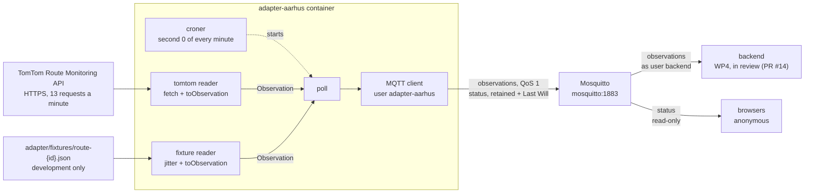
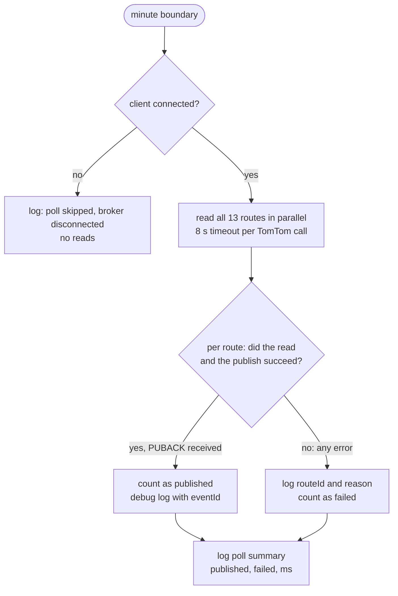

# Aarhus adapter (`adapter-aarhus`)

- **Author:** Christian
- **Status:** Proposed
- **Date:** 2026-11-16, revised 2026-11-17 after review

---

## Overview

The adapter is the first stage of GreenWave's live pipeline. Every minute it
reads each of Aarhus's 13 monitored routes from TomTom's Route Monitoring API,
turns each answer into the shared observation message
(`shared/src/observation.ts`), and publishes it to Mosquitto. It also keeps a
retained `online`/`offline` status for the city, with a Last Will that the
broker publishes if the adapter dies.

For development, a fixture mode replays recorded TomTom responses instead of
calling TomTom, so nobody needs the API key to get a realistic message stream.
Fixture mode is chosen at start-up, and the adapter never switches to it by
itself (Goal 6).

Once plan 05 phase D removes the frontend's copy of the TomTom client, the
adapter is the only component that knows TomTom exists. Everything after it
(backend, live map, history) reads only the observation contract.

**This design is the adapter's specification.** It replaces the technical
content of [plan 03](../implementation-plans/03-adapter.md) and
[WP3](../work-plan/wp3-adapter.md): plan 03 now points here, and WP3 keeps the
owner, dates, summary and "Done when" (files 19 and 20). The broker it
publishes to is on `main` since [PR #13](https://github.com/SlayerDK/greenwave/pull/13).

**What it relies on downstream.** The backend and frontend behaviour this
design relies on (duplicates dropped by `eventId`, state that only moves
forward in time, fixture readings kept out of the history, routes greyed after
five minutes) is what [plan 04](../implementation-plans/04-backend.md) and
[plan 05](../implementation-plans/05-frontend.md) commit to. The backend is in
review as [PR #14](https://github.com/SlayerDK/greenwave/pull/14); the map is
not built yet.

## The Problem

Today TomTom data reaches only the Next.js proof of concept, which calls TomTom
directly when a page renders (with a 60-second cache). Nothing publishes
readings over MQTT. Four things follow:

1.  **The rest of the pipeline has no input.** The backend (WP4) and the live
    map (WP5) both consume observations. Milestone M2 (Mon 16 Nov: real TomTom
    readings reach the browser map every minute) cannot happen until something
    publishes them.
2.  **The backend is being written at the same time, by someone else.** Bjoern
    builds WP4 in parallel (now in review as PR #14). Without a running stream
    of messages that follow the contract, the backend is built against one
    static fixture file (`shared/src/fixtures/observation-56634.json`), and
    mismatches in timing, volume, or field values show up on integration day
    instead of during development. Bjoern and bd-nis also have no TomTom key.
3.  **TomTom's payload has three traps that silently corrupt data**
    (`frontend/CLAUDE.md` → _Traffic_): numeric `segmentId`s lose precision in
    `JSON.parse`, points are `{latitude, longitude}` objects instead of GeoJSON
    `[longitude, latitude]` pairs, and the reading time must come from TomTom's
    `date` header. Any component that handles TomTom's raw format has to get
    all three right.
4.  **Users must not be shown traffic that did not happen.** If the adapter
    filled a TomTom outage with recorded or randomized data, or re-sent its
    last reading, the map would show traffic that TomTom did not report. The
    rule that follows: the adapter never publishes a speed TomTom did not
    report, except in fixture mode, which is chosen on purpose and labelled
    `source: "fixture"`.

**Proposed solution.** A small Node.js service, `@greenwave/adapter`, that runs
on a minute-aligned schedule, reads all routes in parallel, normalizes each
answer into an observation stamped with TomTom's `date` header, validates it
against `observationSchema`, and publishes it at QoS 1. A route that fails is
logged and skipped. While the broker is unreachable, polling pauses and resumes
on reconnect, so no backlog of old readings builds up. A fixture mode replays
one recorded response per route with small random speed changes, labelled
`source: "fixture"`, so the backend team gets the same message stream without a
key. The adapter absorbs all of TomTom's quirks, so no other component needs to
know them.

## Goals

1.  **One observation per answering route per poll.** At each minute boundary,
    publish one message per route that answered to
    `greenwave/v1/aarhus/routes/{routeId}/observations`, QoS 1, not retained.
    With all routes answering, that is 13 messages a minute.
2.  **Live readings carry TomTom's time.** In live mode, `observedAt` is
    TomTom's HTTP `date` header: when TomTom answered. TomTom's response
    carries no measurement time (its only time field, `createdAt`, is when the
    route was set up), so how old the data is cannot be known. The adapter
    uses its own clock only if the header is missing or unreadable, as the
    frontend's `toFetchedAt` does. If TomTom has not refreshed a route since
    the last poll, the same speeds are published again with a new
    `observedAt`; this is accepted ([Risks](#risks-and-accepted-limits)).
3.  **A failed route publishes nothing.** Any failure on one route (a timeout,
    an HTTP error, a format change, or an error nobody predicted) is logged
    with the route id and reason, and nothing is published for that route in
    that poll. The other routes publish normally. The adapter never fills a
    gap: no re-sent reading, no switch to fixtures, no interpolation. Plan 05
    greys a route once its `observedAt` is more than five minutes old ("No
    recent data").
4.  **Nothing malformed reaches the broker.** Every payload passes
    `observationSchema` after `JSON.stringify` and `JSON.parse`, the same steps
    the backend performs on receipt. A route whose answer fails this check is
    treated as a failed route (Goal 3).
5.  **No polling without a broker.** A poll that finds the client disconnected
    is skipped without calling TomTom. A poll waits for the broker to
    acknowledge each publish (PUBACK), and croner starts no new poll while one
    is waiting. Once the adapter reconnects, polling resumes at the next minute
    boundary. At most the one poll that was running when the connection
    dropped (up to 13 messages) is delivered late, with its true `observedAt`
    ([Broker outage](#broker-outage)).
6.  **Fixture mode is for development and needs no key or internet.**
    `ADAPTER_SOURCE=fixture` replays recorded responses with each segment's
    speed varied by up to ±10%, `source: "fixture"`, and `observedAt` set to
    the time of the read. (The recorded files have no TomTom time; a fixed time
    would give every replay the same `eventId`, and plan 04 would drop all but
    the first.) Plan 04 keeps fixture readings out of the history. Fixture
    mode is set at start-up only, and the adapter never switches to it by
    itself. A presenter may start the adapter in fixture mode on purpose, for
    example when TomTom is down during the demo, and must say the map is a
    replay.
7.  **The status topic tells the truth about the adapter process.**
    `greenwave/v1/aarhus/adapter/status` (retained) reads `online` within a few
    seconds of every connect and reconnect. It reads `offline` at once after
    `docker compose stop` (the adapter publishes it) or a crash that closes the
    connection (the broker publishes the Last Will), and within about
    25 seconds when the process hangs or the network drops without closing the
    connection (1.5 × the 15-second keepalive, plus margin).
8.  **Polls never overlap and do not drift.** Each poll starts on the wall-clock
    boundary, and a poll that is still running when the next boundary arrives
    causes that next poll to be skipped and logged, not queued.
9.  **It runs the same way on the host and in Compose.** From a fresh clone,
    with `.env` copied from `.env.example` and both MQTT passwords filled in
    (plus `TOMTOM_API_KEY` for live mode),
    `pnpm --filter @greenwave/adapter dev` works against the broker started by
    `pnpm db:up`, and `docker compose up adapter-aarhus` works with no further
    setup.
10. **A reading can be traced.** Each publish is logged at `debug` with its
    `eventId`, matching plan 04's per-message log, and each poll writes one
    summary line with `published`, `failed` and `ms` (file 8).

## Non-Goals

- **Validation beyond the schemas, deduplication, classification, storage.**
  These belong to the backend ([plan 04](../implementation-plans/04-backend.md)).
  The adapter reports what TomTom says; `tomtomRouteDetailsSchema` and
  `observationSchema` are its only checks.
- **Knowing whether the backend is running.** The adapter's delivery guarantee
  ends at the broker's PUBACK. Until the backend has subscribed once with its
  persistent session, the broker discards every observation. That is expected
  and is not an adapter fault.
- **A disk buffer.** Readings are not kept across a broker outage or an
  adapter crash ([Risks](#risks-and-accepted-limits)).
- **Changing the shared contracts.** The adapter writes `observationSchema`,
  the topic builders and the status messages as they are. If one turns out to
  be wrong, that is a separate `shared/` change reviewed by both teammates
  (WORK-PLAN → _Ways of working_).
- **Removing the frontend's TomTom code or touching the frozen Vercel
  recorder.** Plan 05 phase D removes the frontend copy; Vercel stays frozen
  until after the hand-in.
- **A second city, a second adapter instance, or horizontal scaling.** One
  Aarhus adapter is the required scope (WORK-PLAN → _Required pipeline
  scope_).
- **Scripted traffic scenarios in fixture mode.** Fixture mode adds ±10% noise
  to recorded speeds and nothing else. It will not reliably drive a route into
  or out of congestion; the backend tests its flag logic with unit tests.
- **Managing TomTom's quota.** Out of scope by the author's decision; 13 calls
  a minute is about 18,700 a day.
- **TLS, a secrets manager, a health endpoint or a Compose healthcheck.** The
  stack is local only (plans README → _Deliberate deviations_), nothing waits
  on the adapter, and the retained status topic is its health signal.
- **An exact time in the Last Will.** Its `at` is the connect time
  (`shared/src/status.ts`); the map shows only "offline".

## Open Questions

None. The demo fallback (Goal 6) and PR #13's conflicts with `main` (resolved
and merged on 17 Nov) were settled in review.

## Critical User Journeys (CUJs)

### CUJ 1: Backend development without a TomTom key

- **Given**: a fresh clone, `.env` copied from `.env.example` with both MQTT
  passwords set, and `pnpm db:up` has started Postgres and Mosquitto.
- **When**: the developer runs `pnpm --filter @greenwave/adapter dev` with
  `ADAPTER_SOURCE=fixture`.
- **Then**: at the next minute boundary, a subscriber logged in as `backend`
  receives 13 observations, each of which passes `observationSchema` and
  carries `source: "fixture"`. An anonymous subscriber receives a retained
  `online` status. The same repeats every minute.

### CUJ 2: Live readings, with one route failing

- **Given**: `TOMTOM_API_KEY` is set and `ADAPTER_SOURCE=tomtom`.
- **When**: the adapter runs through several minute boundaries, and TomTom
  refuses one route (for example HTTP 404, 429 or a timeout).
- **Then**: each minute, every route that answered is published with
  `source: "live"` and `observedAt` from TomTom's `date` header. The refused
  route is logged with its id and reason and nothing is published for it.
  (Greying it on the map is plan 05's job.)

### CUJ 3: TomTom is unreachable

- **Given**: the adapter is running in live mode and connected to the broker.
- **When**: every TomTom call fails for several minutes.
- **Then**: the adapter publishes no observations, logs each failed route, and
  its status stays `online` (the process is fine; TomTom is not). When TomTom
  answers again, the next poll publishes. (Greying the routes on the map is
  plan 05's job.)

### CUJ 4: The adapter stops, crashes or hangs

- **Given**: `adapter-aarhus` is running in Compose and its status is
  `online`.
- **When**: it is stopped (`docker compose stop`), killed
  (`docker compose kill`), or frozen (`docker compose pause`), and then
  started or unpaused again.
- **Then**: after a stop the status reads `offline` at once, published by the
  adapter. After a kill the connection closes, so the broker publishes the
  Last Will at once. After a pause the connection stays open, so the broker
  publishes the Last Will within about 25 seconds, when the keepalive runs
  out. After a start or unpause it reads `online` again.

### CUJ 5: The broker restarts

- **Given**: the adapter is running and publishing.
- **When**: `docker compose restart mosquitto`.
- **Then**: while the broker is down, the adapter skips its polls and calls
  TomTom zero times. It reconnects within about 5 seconds of the broker
  returning, publishes `online` again, and polls at the next minute boundary.
  No backlog of readings is sent, apart from at most the one poll that was
  running when the connection dropped, which MQTT.js sends after it
  reconnects.

### CUJ 6: TomTom changes its format

- **Given**: TomTom renames or drops a field the adapter relies on.
- **When**: a poll receives that answer.
- **Then**: that route fails with a log line naming the failing field, and no
  message for it reaches the broker. Routes whose answers still parse publish
  normally.

## Technical Plan (Architecture)

### Where the adapter sits



Only one of the two readers exists in a running adapter; `ADAPTER_SOURCE`
picks it at start-up. The adapter has one input (TomTom over HTTPS, or the
fixture files) and one output (the broker). It reads nothing from Postgres, so
it does not wait for `migrate` in Compose, and it never subscribes to anything.

### Modules

`tomtom-schema.ts`, `tomtom.ts`, `normalize.ts` and `fixtures.ts` handle
TomTom's format. `main.ts` picks the reader and passes it the key. `poll.ts`,
`mqtt.ts` and `env.ts` never see TomTom's payload; `poll.ts` knows only
`TrafficError`, the readers' failure type, to choose a log level.

The package is `@greenwave/adapter` in `adapter/`. Its code lives in
`adapter/src/`, like `shared/src/` and `database/src/`: `.ls-lint.yml`'s naming
rule and the shared `tsconfig` includes assume that layout. After this table,
files are named without the `adapter/src/` prefix.

| File                               | Job                                                                             | Sees TomTom's format | Knows MQTT |
| ---------------------------------- | ------------------------------------------------------------------------------- | -------------------- | ---------- |
| `adapter/src/env.ts`               | Parse and validate the environment once at start-up, with Aarhus defaults       | no                   | no         |
| `adapter/src/tomtom-schema.ts`     | TomTom's Zod schemas and types, `TrafficError` (as the frontend's `schema.ts`)  | yes                  | no         |
| `adapter/src/tomtom.ts`            | HTTP client and the live reader                                                 | yes                  | no         |
| `adapter/src/normalize.ts`         | TomTom route details → `Observation`; `toPositions`, `toRouteLabel`             | yes                  | no         |
| `adapter/src/fixtures.ts`          | Load the recorded responses, vary their speeds, the fixture reader              | yes                  | no         |
| `adapter/src/poll.ts`              | One poll: connection check, parallel reads, publish, summary                    | no                   | no ¹       |
| `adapter/src/mqtt.ts`              | Connect with the Last Will, keep `online` published, publish helper             | no                   | yes        |
| `adapter/src/main.ts`              | Wire it together; pick the reader; the croner schedule; SIGTERM/SIGINT handling | no ²                 | yes        |
| `adapter/fixtures/route-{id}.json` | 13 recorded TomTom responses, as TomTom sent them                               | data                 | no         |

¹ `poll.ts` receives `publish` and `isConnected` as plain functions, so it
never imports MQTT.js.
² `main.ts` passes the key to `createTomTomReader` but never handles a TomTom
payload.

Imports run one way: `tomtom.ts` and `fixtures.ts` import `normalize.ts`, and
all three import `tomtom-schema.ts`, so there is no import cycle for fallow to
report.

The seam between the readers and the poll is one function type, defined in
`poll.ts`, which uses it:

```text
type ReadObservation = (routeId: string) => Promise<Observation>   // rejects on any failure
```

`tomtom.ts` exports `createTomTomReader({ apiKey, cityId })`: it calls
`fetchRouteDetails`, takes `observedAt` from the `date` header, and returns
`toObservation(details, { cityId, observedAt, source: "live" })`. `fixtures.ts`
exports `loadFixtureReader(routeIds, { cityId, random, now })`: it loads every
recorded file at start-up and, on each read, returns
`toObservation(jitterSpeeds(fixture, random), { cityId, observedAt: now().toISOString(), source: "fixture" })`.
`main.ts` picks one from `ADAPTER_SOURCE` at start-up. Nothing else in the
adapter branches on the mode, so fixture and live readings take exactly the
same path from here on.

### Schedule

`main.ts` starts one [croner](https://github.com/Hexagon/croner) job, already
planned for the predictor:

```text
job = new Cron("* * * * *", { protect: onSkip, catch: onBug }, runPoll)
```

- **`"* * * * *"`** fires at second 0 of every minute, on the wall clock, so
  polls do not drift (Goal 8).
- **`protect: onSkip`** stops croner from starting a run while the previous
  one is still going, and calls `onSkip`, which logs
  `poll skipped: previous poll still running` at `warn`. Skipped runs are
  dropped, not queued.
- **`catch: onBug`** receives any error that escapes `runPoll`. Errors on one
  route never reach it ([One poll](#one-poll)), so anything that does is a bug
  outside the per-route code: `onBug` logs it at `fatal` and exits with
  code 1. Passing the handler makes the crash explicit instead of depending on
  how croner treats an uncaught error.
- **Every minute is a constant, not a variable.** Plan 03's
  `POLL_INTERVAL_SECONDS` is dropped: WORK-PLAN → _Decisions_ fixes TomTom
  polling at every minute, and a seconds count that does not divide 60 has no
  cron form.

### One poll



`poll.ts` takes its dependencies as parameters (`readObservation`, `publish`,
`isConnected`, `routeIds`, `cityId`, `logger`), so its tests run with plain
functions in place of TomTom and the broker.

- **Every route fails on its own.** `poll.ts` catches any error from reading
  or publishing one route, logs it, and counts that route as failed; the other
  routes publish normally. A `TrafficError` (an expected TomTom failure) is
  logged at `warn` as `${code}: ${message}`, except `unauthorized` (HTTP 401
  or 403), which is logged at `error` with the hint `check TOMTOM_API_KEY`.
  Anything else is logged at `error` with its stack, because it is either a
  TomTom failure the client does not classify (for example a 200 whose body is
  not JSON, or a body cut off by the timeout) or a bug. A bug therefore shows
  as a stack trace for every route every minute and `failed: 13`, not as a
  crash.
- **Parallel reads.** `Promise.all` over the route ids with an explicit arrow
  (`routeIds.map((id) => runRoute(id))`), for the reason the frontend's
  comment gives: 13 sequential calls with 8-second timeouts could take almost
  two minutes.
- **Schema check at runtime, round trip in tests.** `toObservation` ends with
  `observationSchema.safeParse`; a failure becomes a `TrafficError`
  `invalid_response` naming the first issue's path, the same as a TomTom shape
  change (CUJ 6). Every value in the result comes from a Zod-parsed TomTom
  payload (strings, integers, booleans, arrays), so `JSON.stringify` →
  `JSON.parse` cannot change it; the round trip that Goal 4 describes is
  asserted once in `normalize.test.ts` rather than paid on every message.

### Broker outage

Two mechanisms together give "no polling without a broker" (Goal 5):

1.  A poll checks `client.connected` before calling TomTom and ends at once if
    the client is disconnected.
2.  A poll waits for every PUBACK. If the connection drops after the check,
    MQTT.js keeps the unacknowledged QoS 1 messages in memory and resends its
    whole outgoing store on every reconnect (`_onConnect` in MQTT.js 5.16's
    `client.js`; the store is emptied only when `reconnectPeriod` is 0), so the
    poll ends once the broker is back. Until then croner skips each minute and
    `onSkip` logs it.

| Time     | What happens                                                                 |
| -------- | ---------------------------------------------------------------------------- |
| 12:00:00 | Poll: 13 reads, 13 publishes, 13 PUBACKs, done                               |
| 12:00:40 | The broker goes down                                                         |
| 12:01:00 | Poll: client disconnected, so skipped; no TomTom calls                       |
| 12:02:00 | Poll: skipped again                                                          |
| 12:02:20 | The broker is back; the adapter reconnects within 5 s and publishes `online` |
| 12:03:00 | Poll: normal                                                                 |

If the drop happens during a poll (between the connection check and the last
PUBACK), that poll's messages are delivered after reconnect with their original
`observedAt`, and croner skips the minutes in between. Plan 04's rule that
state only moves forward in time keeps them from overwriting newer state. This
is the "at most one poll late" bound in Goal 5. It is accepted rather than
engineered away, because removing messages from MQTT.js's outgoing store by
hand would add code for a case that costs at most 13 messages.

### Status and Last Will

`mqtt.ts` connects with MQTT 5, client id and username `adapter-${CITY_ID}`,
`keepalive: 15`, `reconnectPeriod: 5000`, and a Last Will of `offlineStatus()`
on `statusTopic(CITY_ID)`, QoS 1, retained. After `connectAsync` resolves it
publishes `onlineStatus()` once and waits for it, then publishes it again on
every later `connect` event, because a dropped connection may already have
triggered the Last Will. A status message is JSON,
`{"status":"online","at":"<ISO time>"}` (`shared/src/status.ts`). The broker's
ACL lets `adapter-aarhus` write exactly
`greenwave/v1/aarhus/routes/+/observations` and
`greenwave/v1/aarhus/adapter/status`.

**Errors.** `mqtt.ts` keeps one `error` listener for the client's lifetime and
logs each error's message at `warn`; MQTT.js reconnects by itself. Without a
listener, Node would crash on the first socket error. If `connectAsync`
rejects, `main.ts` logs the message at `fatal` and exits 1. MQTT.js's
`connectAsync` rejects on the first `error` event, and every socket error with
a code, such as `ECONNREFUSED`, is one, so this covers both a broker that is
not running at start-up and a refused login. In Compose,
`depends_on: service_healthy` waits for the broker and
`restart: unless-stopped` retries; on the host, start the broker first with
`pnpm db:up`.

**Shutdown.** On the first SIGTERM or SIGINT, `main.ts` stops the croner job,
publishes `offlineStatus()` retained at QoS 1, and calls `endAsync()`. A clean
disconnect does not fire the Last Will, so this explicit `offline` is what
makes `docker compose stop` show `offline` at once. If the broker is down, the
publish waits for it; a second signal exits at once with code 1, and in Compose
`stop_grace_period: 10s` ends it. A poll that is running during shutdown is
abandoned and its readings are lost ([Risks](#risks-and-accepted-limits)).

### Data mapping

`toObservation(details, { cityId, observedAt, source })` in `normalize.ts`
builds the observation below, with `schemaVersion: 1`, and ends with the schema
check described in [One poll](#one-poll).

| Observation field                                                                                                  | From TomTom                                                                                    | Trap it avoids                        |
| ------------------------------------------------------------------------------------------------------------------ | ---------------------------------------------------------------------------------------------- | ------------------------------------- |
| `eventId`                                                                                                          | `toEventId(cityId, routeId, observedAt)`                                                       | same reading → same id → deduplicated |
| `source`, `cityId`, `observedAt`                                                                                   | the reader's values (see below)                                                                | not the adapter's clock in live mode  |
| `routeId`                                                                                                          | `String(details.routeId)`                                                                      | ids are strings everywhere downstream |
| `route.name`                                                                                                       | `toRouteLabel(routeName)`                                                                      | `CW_AU_` prefix                       |
| `route.lengthM`, `travelTimeSec`, `typicalTravelTimeSec`, `delaySec`, `passable`                                   | `routeLength`, `travelTime`, `typicalTravelTime`, `delayTime`, `passable`                      | unit suffixes make units explicit     |
| `segments[].id`                                                                                                    | `segmentIdStr`                                                                                 | `segmentId` loses precision           |
| `segments[].coordinates`                                                                                           | `toPositions(shape)`                                                                           | `[longitude, latitude]` order         |
| `segments[].lengthM`, `currentSpeedKmh`, `averageSpeedKmh`, `typicalSpeedKmh`, `relativeSpeedPct`, `confidencePct` | `segmentLength`, `currentSpeed`, `averageSpeed`, `typicalSpeed`, `relativeSpeed`, `confidence` | none                                  |

`observedAt` per mode:

- **live:** `toFetchedAt(response.headers.get("date"))`, as in the frontend
  (Goal 2). The 13 calls in one poll can get headers a second apart; each
  route keeps its own.
- **fixture:** `now()` at the time of each read. The recorded files hold only
  the body, and each poll needs a new time or its `eventId`s repeat (Goal 6).

### Fixture mode

Christian records the fixtures once with a curl loop (file 11): `curl -o`
saves each response's bytes unchanged. Parsing and re-serializing would round
every `segmentId`. `adapter/fixtures` goes into `.prettierignore`, so
`lint-staged` cannot reformat the files on commit.

`loadFixtureReader` parses every file through `tomtomRouteDetailsSchema` (which
drops `segmentId`) at start-up. On each read it multiplies each segment's
`currentSpeed` and `relativeSpeed` by the same factor drawn from [0.9, 1.1],
rounding both to integers. Everything else, including route travel times, stays
as recorded. The random source is a parameter, so tests are deterministic.

### Configuration

| Variable                | Required      | Value / default                                                                                     |
| ----------------------- | ------------- | --------------------------------------------------------------------------------------------------- |
| `CITY_ID`               | no            | default `aarhus` (`[a-z0-9-]+`, it becomes a topic level and the username)                          |
| `ROUTE_IDS`             | no            | default the 13 Aarhus ids; an override is comma-separated, spaces are trimmed                       |
| `ADAPTER_SOURCE`        | yes           | `tomtom` or `fixture`                                                                               |
| `TOMTOM_API_KEY`        | when `tomtom` | from `.env`; never committed                                                                        |
| `MQTT_URL`              | yes           | `mqtt://localhost:1883` on the host (already in `.env.example`), `mqtt://mosquitto:1883` in Compose |
| `MQTT_ADAPTER_PASSWORD` | yes           | from `.env`, the same value `mosquitto-init` hashes                                                 |
| `LOG_LEVEL`             | no            | default `info`; `debug` adds one line per publish with its `eventId`                                |

`env.ts` holds the defaults (file 3), so the route list exists once in code,
next to the fixtures it must match, and an existing `.env` keeps working. On
failure, `main.ts` prints the Zod message and exits 1 before connecting.
`.env.example` gains `ADAPTER_SOURCE="fixture"`. In Compose, `MQTT_URL` is set
to `mqtt://mosquitto:1883`; the other values come from `.env` (file 14).

### Running it

- **Host (day-to-day):** `pnpm db:up` starts Postgres and Mosquitto;
  `pnpm --filter @greenwave/adapter dev` runs the adapter with `tsx watch`
  and the root `.env`.
- **Compose:** service `adapter-aarhus`, built with the Dockerfile pattern
  from [plan 02](../implementation-plans/02-migrate.md), `init: true`,
  `depends_on: mosquitto: service_healthy`, `restart: unless-stopped`.
  Compose runs whatever `.env` says; `.env.example` says `fixture`, so set
  `ADAPTER_SOURCE=tomtom` for live data. The `started` log line names the
  source.
- **Never both at once.** They share the client id `adapter-aarhus`. The
  broker disconnects the older connection when the newer one arrives, which
  fires its Last Will, and both reconnect every 5 seconds, so the status
  flips between `online` and `offline` and readings are published twice.
- **Checking the output needs two subscribers**, because of the ACL:
  observations are readable only as `backend`, and the status only
  anonymously. One `mosquitto_sub -u backend -t 'greenwave/v1/aarhus/#'`
  never shows the status. Both run inside the broker container, after
  `set -a; source .env; set +a`:

  ```text
  docker compose exec mosquitto mosquitto_sub -v -u backend -P "$MQTT_BACKEND_PASSWORD" -t 'greenwave/v1/aarhus/routes/+/observations'
  docker compose exec mosquitto mosquitto_sub -v -t 'greenwave/v1/aarhus/adapter/status'
  ```

- **What the backend will see.** Until the backend subscribes for the first
  time, the broker has no session to queue into and discards observations.
  Once it has subscribed as `backend-1`, the broker queues up to 1,000
  messages (about 75 minutes at 13 a minute) during a backend outage of up to
  an hour. The adapter needs no change when the backend arrives: the topic,
  QoS and payload are the contract.

## Alternatives Considered

A, B, C and E were decided by the author during this design; D confirms what
`ARCHITECTURE.md` and plan 03 already said; F–H were decided in plan 03 or
`ARCHITECTURE.md`, which give their reasons.

### Alternative A: Re-send the last successful reading when TomTom fails

- **Pros**: The stream keeps a message per route per minute, so "no message"
  always means the adapter or broker is down, never TomTom.
- **Cons**: Re-sent unchanged, it has the same `observedAt` and so the same
  `eventId`; plan 04 drops it as a duplicate, and the map ends up exactly
  where it would with no message. Every re-send also adds one to plan 04's
  duplicate count ([_Metrics_](../implementation-plans/04-backend.md#metrics)),
  which WP7 uses as evidence of duplicate handling. Re-sent with a new
  `observedAt`, it would pass deduplication, add a copy to the history every
  minute of the outage, and advance the
  [route flags](../implementation-plans/04-backend.md#1--pure-rules-rulests-first-and-fully-tested)'
  three-in-a-row counts on repeated data. After an adapter restart there is
  nothing in memory to re-send.
- **Reason for Rejection**: Rejected by author: it either has no effect or
  fills the history with repeated data for as long as TomTom is down. Plan 05
  greys routes whose `observedAt` is over five minutes old, so publishing
  nothing is enough.

### Alternative B: Fall back to fixture data automatically when TomTom is unreachable

- **Pros**: The map keeps moving during a TomTom outage, and the demo cannot
  stall on TomTom.
- **Cons**: The jittered speeds are random noise around an old recording. The
  map would show speeds TomTom did not report, and nobody would have chosen
  it.
- **Reason for Rejection**: Rejected by author: the adapter never publishes a
  speed TomTom did not report unless someone chose fixture mode at start-up.
  Fixture mode is for development, or a demo that says it is a replay
  (Goal 6).

### Alternative C: Keep polling during a broker outage and let MQTT.js queue

- **Pros**: No reading is lost during a short outage; the backend gets a
  complete history once the broker returns, which the predictor uses.
- **Cons**: The backlog is old by the time it arrives, grows by
  13 observations a minute in memory (the Ringvejen route alone is about
  38 KB; `ARCHITECTURE.md` → _Self-contained messages_), and is lost anyway if
  the adapter dies first. TomTom is still called every minute for readings
  nobody can receive.
- **Reason for Rejection**: Rejected by author: the pipeline exists to serve
  live data, and a backlog of stale readings does not serve it. The accepted
  cost is a gap in the history as long as the outage. Polling pauses while
  disconnected (Goal 5).

### Alternative D: Stamp `observedAt` with the adapter's own clock

- **Pros**: Simpler, and identical across the 13 routes of one poll.
- **Cons**: The adapter's clock says when it read the data, which is no closer
  to the measurement time than TomTom's header, and it depends on the
  container's clock being right.
- **Reason for Rejection**: Rejected by author, confirming `ARCHITECTURE.md`
  and plan 03: the timestamp should come from TomTom. Fixture mode is the one
  exception, because recordings carry no time (Goal 6).

### Alternative E: A hand-written scheduler (plan 03's `scheduler.ts`)

- **Pros**: No new dependency; any interval in seconds; full control over
  skip handling.
- **Cons**: About 20 lines of timer code, plus a fake-timer test
  (`scheduler.test.ts`), to do what croner's `protect` option already does.
- **Reason for Rejection**: Rejected by author in favour of croner: it is
  already planned for the predictor, has overlap protection with a skip
  callback built in, and removes a module and a test. The cost, polling at
  a fixed minute instead of a configurable number of seconds, matches the
  project's decision to poll every minute.

### Alternative F: Move the TomTom client out of the frontend instead of copying it

- **Pros**: One copy of `fetchRouteDetails`, the schemas and the
  normalization helpers.
- **Cons**: The adapter PR would also have to change the frontend, which
  still uses the code until plan 05 phase D. `shared/` cannot hold it either,
  because it runs in the browser and must stay free of anything that handles
  the API key.
- **Reason for Rejection**: Rejected by author in plan 03: copying keeps the
  adapter PR independent of the frontend's; phase D deletes the frontend's
  copy.

### Alternative G: Publish TomTom's raw payload and normalize in the backend

- **Pros**: A thinner adapter.
- **Cons**: The backend, and every consumer after it, would have to know
  TomTom's format and its three traps; a second city would mean changing the
  backend.
- **Reason for Rejection**: Rejected by author in `ARCHITECTURE.md` (_The
  adapter normalizes, the backend classifies_): each adapter absorbs its
  city's quirks, so everything downstream reads one format.

### Alternative H: Leave schema validation to the backend

- **Pros**: One validation point instead of two.
- **Cons**: A TomTom format change would surface as rejected messages in
  another service's logs, owned by another person, instead of where the
  format is known.
- **Reason for Rejection**: Rejected by author in plan 03: the schema check
  runs before publishing, so format drift fails in the adapter with a clear
  error. Plan 04 still validates on receipt.

---

## Risks and accepted limits

| Risk                                                 | Effect                                                              | Mitigation or accepted                                                                    |
| ---------------------------------------------------- | ------------------------------------------------------------------- | ----------------------------------------------------------------------------------------- |
| TomTom outage, or one route failing                  | No data for those routes                                            | Publish nothing (Goal 3); plan 05's map shows the data's age                              |
| TomTom has not refreshed a route since the last poll | The same speeds are published again with a new `observedAt`         | Accepted: the response carries no measurement time to detect it (Goal 2)                  |
| Broker outage                                        | Polling pauses; at most the poll that was running is delivered late | Accepted; MQTT.js resends it on reconnect ([Broker outage](#broker-outage))               |
| Adapter crash, or a poll running during shutdown     | Readings held in memory are lost                                    | Accepted; the Last Will shows `offline` and Compose restarts the container                |
| Bad or placeholder TomTom key                        | Every route fails                                                   | `error` lines naming the key ([One poll](#one-poll))                                      |
| Host and Compose adapters running at once            | The status flips; readings are published twice                      | Documented rule: never both ([Running it](#running-it))                                   |
| The frozen Vercel recorder uses the same key         | Calls to TomTom add up                                              | Accepted; the quota is out of scope by the author's decision                              |
| Fixture data mistaken for live                       | The map shows a replay as traffic                                   | The `source` field, the `started` log line, and Goal 6's rule (a presenter says it aloud) |

## Non-Functional Requirements

- **Security & Privacy**: The TomTom key and the MQTT password come from the
  root `.env` (or Compose's environment) and are never committed or logged.
  The TomTom request URL carries the key as a query parameter, so the URL is
  never logged, and neither are MQTT.js's connect options. The broker's ACL
  limits `adapter-aarhus` to writing Aarhus observations and its own status.
  Everything is local and without TLS, as the plans README's _Deliberate
  deviations_ already accept. The data is aggregate road speeds with no
  personal information.
- **Performance & Latency**: 13 HTTPS calls a minute, each with an 8-second
  timeout, and 13 publishes; the CUJ 1 run records the bytes published per
  minute. A poll's reads end within 8 seconds. Waiting for PUBACKs has no
  limit, but croner skips, rather than queues, every minute a poll overlaps
  ([Broker outage](#broker-outage)).
- **Rollout & Rollback**: `wp3-adapter` merges into `main`. Nothing waits on
  `adapter-aarhus` at start-up, so rolling back means stopping or removing
  that one service. The frozen Vercel deployment is not touched.

---

### Additional Resources

- [`ARCHITECTURE.md`](../../ARCHITECTURE.md) → _MQTT design_, _Observation
  message_, _Backend_.
- [Plan 01 · Broker](../implementation-plans/01-broker.md),
  [`broker/README.md`](../../broker/README.md) and
  [`broker/acl`](../../broker/acl): users, ACL, session and queue limits.
- [Plan 04 · Backend](../implementation-plans/04-backend.md) and
  [plan 05 · Frontend](../implementation-plans/05-frontend.md): how the
  observations and the status are consumed, and the five-minute stale rule.
- [`frontend/CLAUDE.md`](../../frontend/CLAUDE.md) → _Traffic_: the three
  TomTom traps and the code being copied.
- `shared/src/observation.ts`, `topics.ts`, `status.ts`: the contracts.
- [PR #13](https://github.com/SlayerDK/greenwave/pull/13): the broker, merged
  into `main` on 17 Nov. [PR #14](https://github.com/SlayerDK/greenwave/pull/14):
  the backend, in review.

---

## Detailed Implementation Plan

### Order of work

The work is ordered so the backend developer gets a running fixture stream as
early as possible. The broker is on `main`, so no phase waits on another PR.

| Phase | Needs                                                             | Files, in order                     | Ends with                                                                         |
| ----- | ----------------------------------------------------------------- | ----------------------------------- | --------------------------------------------------------------------------------- |
| 1     | the TomTom key and internet: Christian records the fixtures first | 17, 11, 1 (phase 1 part), 2–8, 12   | `pnpm test --run` passes, including the fixture tests on the committed recordings |
| 2     | phase 1                                                           | 1 (phase 2 part), 9, 10, 15, 16, 18 | CUJ 1 on the host; tell Bjoern fixture mode is ready                              |
| 3     | phase 2                                                           | 13, 14                              | CUJ 4 in Compose                                                                  |
| 4     | the TomTom key                                                    | none (live runs)                    | CUJs 2, 3 and 5 with live TomTom                                                  |
| 5     | phases 1–4                                                        | 19–26, including the report (24)    | one PR against `main`, reviewed with the WORK-PLAN checks                         |

### Branch

`wp3-adapter` branches from `main` after PR #13 merged (`75571d9`); its PR
targets `main`.

- **Running the stream before this PR merges:** check out `wp3-adapter`, run
  `pnpm db:up` (and `pnpm db:migrate` if the backend runs too), then
  `pnpm --filter @greenwave/adapter dev` with `ADAPTER_SOURCE=fixture`.
- **Bjoern's backend PR #14** also edits `compose.yaml`, `.env.example` and
  `pnpm-lock.yaml`; whichever of the two PRs merges second resolves those
  conflicts.

Copy, don't import, from the frontend: nothing may import across container
directories (`CLAUDE.md` → _Layout_).

### Target Files to Create/Modify

#### 1. `adapter/package.json` (Create)

- **Type / Scope**: Workspace package manifest.
- **Proposed Changes**: Name `@greenwave/adapter`, `"private": true`,
  `"type": "module"`. Add dependencies with pnpm, not by hand, each in the
  phase whose code or script first uses it: fallow reports an unused
  dependency as an error, and the pre-push `fallow audit` would block the
  push.
  - **Phase 1:**
    `pnpm add "@greenwave/shared@workspace:*" zod@catalog: pino@catalog: --filter @greenwave/adapter`
    (`pino` for the `Logger` type in `poll.ts`) and
    `pnpm add -D @types/node@catalog: typescript@catalog: vitest@catalog: --filter @greenwave/adapter`;
    the `typecheck` script.
  - **Phase 2:** `pnpm add croner --save-catalog --filter @greenwave/adapter`
    (croner is new to the catalog), `pnpm add mqtt@catalog: --filter @greenwave/adapter`
    and `pnpm add -D pino-pretty@catalog: tsx@catalog: --filter @greenwave/adapter`;
    the `dev` and `start` scripts.

  | Script      | Command                                                        |
  | ----------- | -------------------------------------------------------------- |
  | `dev`       | `tsx watch --env-file=../.env src/main.ts \| pino-pretty`      |
  | `start`     | `node --import tsx src/main.ts` (the same as the Docker `CMD`) |
  | `typecheck` | `tsc --noEmit`                                                 |

#### 2. `adapter/tsconfig.json` (Create)

- **Type / Scope**: TypeScript configuration.
- **Proposed Changes**: Extends `../tsconfig.base.json` (which already sets
  `types: ["node"]`) and includes `src/**/*.ts`. Needed for `pnpm typecheck`
  and for ESLint's `projectService`.

#### 3. `adapter/src/env.ts` (Create)

- **Type / Scope**: Configuration parsing.
- **Proposed Changes**: Exports `AARHUS_ROUTE_IDS` (the 13 ids:
  `56634, 56628, 313719, 313720, 313721, 313722, 313723, 313724, 313725, 313726, 313727, 313728, 313729`)
  and `adapterEnvSchema`:

  ```text
  base = {
    CITY_ID:               string matching /^[a-z0-9-]+$/, default "aarhus"
    ROUTE_IDS:             comma-separated string → trimmed, non-empty ids, each matching /^\d+$/
                           (safe in a URL and as a topic level), at least one; default AARHUS_ROUTE_IDS
    MQTT_URL:              z.url()
    MQTT_ADAPTER_PASSWORD: non-empty string
    LOG_LEVEL:             "fatal" | "error" | "warn" | "info" | "debug" | "trace", default "info"
  }
  adapterEnvSchema = z.discriminatedUnion("ADAPTER_SOURCE", [
    base + { ADAPTER_SOURCE: "tomtom", TOMTOM_API_KEY: non-empty string },
    base + { ADAPTER_SOURCE: "fixture" },
  ])
  ```

- **Why**: one place that rejects bad configuration before any connection is
  made, and the one copy of the route list.

#### 4. `adapter/src/tomtom-schema.ts` (Create)

- **Type / Scope**: TomTom's data types.
- **Proposed Changes**: Copy from `frontend/src/lib/traffic/schema.ts` only
  what the adapter uses: the point, segment and route-details schemas
  (segment schema without `segmentId`, with its comment),
  `tomtomErrorBodySchema`, `TomTomRouteDetails`, `TrafficErrorCode` and
  `TrafficError`. Not `MONITORED_ROUTE_IDS`, `TRAFFIC_REFRESH_SECONDS` or
  `trafficTag`, and no type nothing imports (fallow flags unused exports).
- **Why**: its own file, as in the frontend, so `tomtom.ts` → `normalize.ts`
  → `tomtom-schema.ts` has no import cycle.

#### 5. `adapter/src/tomtom.ts` (Create)

- **Type / Scope**: TomTom HTTP client and the live reader.
- **Proposed Changes**: Copy from
  `frontend/src/lib/traffic/tomtom-service.ts`: `ROUTES_URL`,
  `REQUEST_TIMEOUT_MS = 8_000`, `toFetchedAt`, `toErrorCode`,
  `toErrorMessage`, `fetchRouteDetails`. Then change:
  - `fetchRouteDetails(routeId: string, apiKey: string): Promise<{ details; observedAt: string }>`.
    No `server-only`, no `env` import, no `next` fetch option, no
    `revalidateSeconds`. `fetchedAt` is renamed `observedAt` to match the
    contract.
  - The `invalid_response` message names the first Zod issue as
    `"<path>: <message>"`, with the path joined with `.` (for example
    `detailedSegments.3.currentSpeed`) (CUJ 6).
  - The body read stays as copied: a 200 whose body is not JSON, or a body
    the timeout cuts off, rejects with an error that is not a `TrafficError`,
    which `poll.ts` handles like any other route failure.
  - New `createTomTomReader({ apiKey, cityId }): (routeId: string) => Promise<Observation>`,
    returning `toObservation(details, { cityId, observedAt, source: "live" })`.
  - Do not copy `readMonitoredRoutes` or `readRoute`; `poll.ts` does the
    fan-out.
  - Never log the URL: it contains the key.

#### 6. `adapter/src/normalize.ts` (Create)

- **Type / Scope**: Transformation and the schema check.
- **Proposed Changes**: Copy `toPosition`, `toPositions`,
  `ROUTE_NAME_PREFIX` and `toRouteLabel` with their comments from
  `frontend/src/lib/traffic/serialization.ts`, typing a position as
  `[longitude: number, latitude: number]` instead of importing `geojson`. Add
  `toObservation(details, { cityId, observedAt, source }): Observation`,
  which builds the fields in Technical Plan → [Data mapping](#data-mapping)
  and ends with `observationSchema.safeParse`. On failure it throws
  `new TrafficError("invalid_response", 502, "<path>: <message>")` for the
  first issue, in the same format as `fetchRouteDetails`.

#### 7. `adapter/src/fixtures.ts` (Create)

- **Type / Scope**: Development data source.
- **Proposed Changes**:
  - `jitterSpeeds(details, random: () => number): TomTomRouteDetails`
    returns a new object. Per segment, `factor = 0.9 + 0.2 × random()`;
    `currentSpeed` and `relativeSpeed` are each multiplied by `factor` and
    rounded. Nothing else changes.
  - `loadFixtureReader(routeIds, { cityId, random = Math.random, now = () => new Date() }): Promise<(routeId: string) => Promise<Observation>>`
    reads every `adapter/fixtures/route-{id}.json` at start-up (path
    resolved from `import.meta.url`) and parses each through
    `tomtomRouteDetailsSchema`. A missing or invalid file rejects with an
    error naming the file, so the adapter exits 1 at start-up instead of
    failing one route every minute. Each read returns
    `toObservation(jitterSpeeds(fixture, random), { cityId, observedAt: now().toISOString(), source: "fixture" })`.

#### 8. `adapter/src/poll.ts` (Create)

- **Type / Scope**: One poll, independent of TomTom's format and of MQTT.js.
- **Proposed Changes**: Exports the types `ReadObservation` (Technical Plan →
  [Modules](#modules)) and

  ```text
  type PollSummary =
    | { status: "skipped" }                                              // broker disconnected; nothing read
    | { status: "done"; published: number; failed: number; ms: number }
  ```

  and `createPoll(deps): () => Promise<PollSummary>` with
  `deps = { cityId, routeIds, readObservation, publish(topic, payload): Promise<void>, isConnected(): boolean, logger }`.
  Behaviour, in order:
  1.  If `!isConnected()`: log `info` "poll skipped: broker disconnected" and
      return `{ status: "skipped" }`. `readObservation` is not called.
  2.  For every route id in parallel, `runRoute(routeId)`: read the
      observation, then `publish(observationTopic(cityId, observation.routeId), JSON.stringify(observation))`,
      which resolves on the PUBACK. On success, log `debug` with the
      `eventId`. On any error, log it by the rules in Technical Plan →
      [One poll](#one-poll); a rejected publish (for example a PUBACK with
      reason code 135, not authorized) is logged at `error` with the route
      id.
  3.  Log `info` `{ msg: "poll", published, failed, ms }` and return
      `{ status: "done", published, failed, ms }`.

  Counting: `published` counts acknowledged publishes; `failed` counts routes
  whose read or publish failed; `published + failed` equals the number of
  routes. "Skipped" means only a poll that found the broker disconnected: a
  run croner skips because the previous one is still running never starts,
  so it has no summary (`onSkip` logs it), and a failed route is "failed",
  never "skipped".

#### 9. `adapter/src/mqtt.ts` (Create)

- **Type / Scope**: Broker connection.
- **Proposed Changes**:
  `connectAdapter({ url, cityId, password, logger }): Promise<AdapterConnection>`,
  with `AdapterConnection = { publish(topic, payload): Promise<void>; isConnected(): boolean; close(): Promise<void> }`.
  - `mqtt.connectAsync(url, { protocolVersion: 5, clientId: "adapter-<cityId>", username: "adapter-<cityId>", password, keepalive: 15, reconnectPeriod: 5_000, will: { topic: statusTopic(cityId), payload: offlineStatus(), qos: 1, retain: true } })`.
    It rejects at once if the broker is unreachable or refuses the login;
    `connectAdapter` lets the rejection through to `main.ts`.
  - Right after connecting, add the one `error` listener for the client's
    lifetime (message only, at `warn`).
  - Publish `onlineStatus()` (QoS 1, retained) and wait for it, then publish
    it again on every later `connect` event. A failed status publish is
    logged at `warn`.
  - Log `connect` at `info`, `reconnect` at `debug`, and `offline` and
    `close` at `warn`, each with the error's message only where there is
    one. Never log the connect options: they hold the password.
  - `publish` sends QoS 1, not retained, with `publishAsync`. `isConnected`
    returns `client.connected`.
  - `close()` publishes `offlineStatus()` retained at QoS 1, then calls
    `endAsync()`. No timer: a second signal ends a shutdown that waits on a
    broker that is down (file 10).

#### 10. `adapter/src/main.ts` (Create)

- **Type / Scope**: Entry point.
- **Proposed Changes**:
  1.  Register the signal handlers first:
      `process.on("SIGTERM", () => void shutdown())`, and the same for
      `SIGINT` (the `void` keeps `@typescript-eslint/no-misused-promises`
      quiet). On the first signal, `shutdown` exits 0 at once if there is no
      connection yet; otherwise it calls `job.stop()`,
      `await connection.close()` and `process.exit(0)`. A second signal calls
      `process.exit(1)`.
  2.  `adapterEnvSchema.safeParse(process.env)`; on failure write
      `z.prettifyError(error)` to stderr and exit 1.
  3.  `logger = pino({ level: env.LOG_LEVEL })`.
  4.  `readObservation` = `createTomTomReader({ apiKey: env.TOMTOM_API_KEY, cityId: env.CITY_ID })`
      for `tomtom`, or `await loadFixtureReader(env.ROUTE_IDS, { cityId: env.CITY_ID })`
      for `fixture`.
  5.  `connection = await connectAdapter(…)`; if it rejects, log the message
      at `fatal` and exit 1.
  6.  `poll = createPoll(…)`;
      `job = new Cron("* * * * *", { protect: onSkip, catch: onBug }, poll)`,
      as in Technical Plan → [Schedule](#schedule). `onSkip` logs at `warn`.
      `onBug` logs at `fatal` and calls `process.exit(1)`, so the Last Will
      fires and Compose restarts the container.
  7.  Log `info` "started" with `cityId`, `source` and the number of routes,
      never the environment.

#### 11. `adapter/fixtures/route-{id}.json` × 13 (Create)

- **Type / Scope**: Recorded test and development data.
- **Proposed Changes**: Christian records all 13 in one run, from the repo
  root, after file 17 is in place:

  ```sh
  set -a; source .env; set +a
  for id in 56634 56628 313719 313720 313721 313722 313723 313724 313725 313726 313727 313728 313729; do
    curl -fsS "https://api.tomtom.com/routemonitoring/3/routes/$id/details?key=$TOMTOM_API_KEY" \
      -o "adapter/fixtures/route-$id.json" || { echo "route $id failed; re-run all 13"; break; }
  done
  ```

  `-f` makes a non-2xx answer a failure; a 200 with a wrong body is caught by
  `fixtures.test.ts` once file 12 exists. If any file fails, re-run the whole
  loop and commit all 13 together, so the fixtures show one moment in time.
  Do not paste the loop's output anywhere: a curl error can include the URL,
  which holds the key. The two older recordings in
  `frontend/src/lib/traffic/fixtures/` are not reused: they were reformatted
  and are from different days.

#### 12. Tests (Create), next to the code

| File                            | Cases                                                                                                                                                                                                                                                                                                                                                                                                                                                                                                                                                                                                                  |
| ------------------------------- | ---------------------------------------------------------------------------------------------------------------------------------------------------------------------------------------------------------------------------------------------------------------------------------------------------------------------------------------------------------------------------------------------------------------------------------------------------------------------------------------------------------------------------------------------------------------------------------------------------------------------- |
| `adapter/src/env.test.ts`       | `tomtom` without a key fails; `fixture` without one passes; with nothing else set, `CITY_ID` is `aarhus`, `ROUTE_IDS` is `AARHUS_ROUTE_IDS` and `LOG_LEVEL` is `info`; an override `" 1, 2 ,3"` → `["1","2","3"]`; an empty or non-numeric `ROUTE_IDS` fails; `CITY_ID` `"Aarhus"` fails                                                                                                                                                                                                                                                                                                                               |
| `adapter/src/tomtom.test.ts`    | Ported from `frontend/src/lib/traffic/tomtom-service.test.ts` with `fetch` stubbed, minus the cache cases: key sent as the `key` query parameter; validated payload returned; `observedAt` from the `date` header; local clock when there is no header; the 401 and 404 error envelopes; 429 → `rate_limited`; shape drift → `invalid_response` naming the path; network failure → `network`; a 200 whose body is not JSON rejects, not with a `TrafficError`; `createTomTomReader` returns an `Observation` with `source: "live"`                                                                                     |
| `adapter/src/normalize.test.ts` | On `route-56634.json` and `route-313727.json`: passes `observationSchema`; equal to itself after `JSON.stringify` → `JSON.parse` → `observationSchema.parse` (Goal 4); every segment id equals the raw file's `segmentIdStr` (164 of 165 differ from `String(segmentId)` after `JSON.parse` on 56634); the first coordinate is longitude first; `CW_AU_` trimmed; `eventId` is `aarhus:56634:<observedAt>`; a speed of `12.5` → `TrafficError` `invalid_response` naming the segment's path                                                                                                                            |
| `adapter/src/fixtures.test.ts`  | With `random = () => 0` every speed is 0.9× and with `() => 0.999` about 1.1×, rounded to integers; ids, geometry and route fields unchanged; the reader gives `source: "fixture"` and `observedAt` from `now` on each read; a missing file rejects and names it; all 13 committed files load (`AARHUS_ROUTE_IDS`) and each produces an `Observation` that passes `observationSchema`; in every committed file each `"segmentId": <digits>` has the same digits as the `segmentIdStr` after it (proves no file was re-serialized)                                                                                      |
| `adapter/src/poll.test.ts`      | Uses `shared/src/fixtures/observation-56634.json`, with the route id changed per route. Disconnected → `{ status: "skipped" }`, `readObservation` never called; one `TrafficError` (`network`) → 12 published, 1 failed, logged at `warn`; an `unauthorized` `TrafficError` → logged at `error` with `check TOMTOM_API_KEY`; a `TypeError` from `readObservation` → that route failed, logged at `error`, the other 12 published; payloads parse with `observationSchema` and go to `observationTopic(cityId, routeId)`; a rejected publish → counted as failed, the rest published; `published + failed` is always 13 |

The removed `scheduler.test.ts` is not written: croner's `protect` is the
library's job, and `poll.test.ts` covers the adapter's own logic.

#### 13. `adapter/Dockerfile` (Create)

- **Type / Scope**: Container image.
- **Proposed Changes**: Copy `database/Dockerfile` up to and including
  `RUN pnpm fetch`, unchanged, including the OpenSSL line the adapter does
  not need, so every service image shares those layers (its own comment says
  so). Then `COPY tsconfig.base.json ./`, `COPY shared shared`,
  `COPY adapter adapter`,
  `RUN pnpm install --offline --frozen-lockfile --ignore-scripts --filter "@greenwave/adapter..."`,
  `USER node`, `WORKDIR /app/adapter`,
  `CMD ["node", "--import", "tsx", "src/main.ts"]`. No Prisma generate step.

#### 14. `compose.yaml` (Modify)

- **Type / Scope**: Service wiring.
- **Proposed Changes**: Add after `mosquitto`:

  ```yaml
  adapter-aarhus:
    build: { context: ., dockerfile: adapter/Dockerfile }
    init: true # forwards SIGTERM to node and reaps children
    environment:
      ADAPTER_SOURCE: ${ADAPTER_SOURCE:?choose tomtom or fixture in .env}
      TOMTOM_API_KEY: ${TOMTOM_API_KEY:-}
      MQTT_URL: mqtt://mosquitto:1883
      MQTT_ADAPTER_PASSWORD: ${MQTT_ADAPTER_PASSWORD:?set it in .env}
      LOG_LEVEL: ${LOG_LEVEL:-info}
    depends_on:
      mosquitto: { condition: service_healthy }
    restart: unless-stopped
    stop_grace_period: 10s
  ```

  `CITY_ID` and `ROUTE_IDS` use `env.ts`'s defaults. `TOMTOM_API_KEY` is read
  only in live mode. No `migrate` dependency and no ports.

#### 15. `.env.example` (Modify)

- **Type / Scope**: Developer configuration.
- **Proposed Changes**: Add `ADAPTER_SOURCE="fixture"` with the comment
  "`fixture` replays recorded responses (development, or a demo announced as
  a replay); `tomtom` calls TomTom with `TOMTOM_API_KEY`". Change the
  `TOMTOM_API_KEY` comment to "used by the live adapter and the Next app until
  plan 05 phase D". `MQTT_URL` and `MQTT_ADAPTER_PASSWORD` are already there
  (PR #13).

#### 16. `pnpm-workspace.yaml` and `pnpm-lock.yaml` (Modify)

- **Type / Scope**: Dependencies.
- **Proposed Changes**: The `pnpm add` commands in file 1 add `croner` to the
  catalog and update the lockfile. In the phase that adds each of `pino`
  (phase 1), `mqtt` and `pino-pretty` (phase 2), delete its
  `# fallow-ignore-next-line unused-catalog-entry` line, and delete the
  sentence about them in the comment above once all three are gone: fallow
  flags stale suppressions.

#### 17. `.prettierignore` (Modify)

- **Type / Scope**: Formatter configuration.
- **Proposed Changes**: Add `adapter/fixtures`, so `lint-staged` cannot
  reformat the recorded responses on commit.

#### 18. `.fallowrc.json` (Modify only if `pnpm analyze` asks)

- **Type / Scope**: Static analysis configuration.
- **Proposed Changes**: If `pnpm analyze` reports `adapter/src/main.ts` as
  unused, add it under `entry` (plan 00's rule). Otherwise leave the file
  alone.

#### 19. `docs/implementation-plans/03-adapter.md` (Modify)

- **Type / Scope**: Hand-off plan.
- **Proposed Changes**: Keep the header line (WP3 · Christian · dates ·
  Needs · Unblocks · ← Plans) and the Goal paragraph. Replace everything
  else with one paragraph: the adapter's specification is
  [this design](adapter.md), which replaced this plan's steps after review.

#### 20. `docs/work-plan/wp3-adapter.md` (Modify)

- **Type / Scope**: Work package summary.
- **Proposed Changes**: Keep the owner and dates line and the "Done when"
  paragraph; point the implementation-plan note at this design. Replace the
  five bullets, the code sample, the SIGTERM paragraph and the env line with
  a one-paragraph summary and a link here. "Done when": the two subscribers
  from Technical Plan → [Running it](#running-it).

#### 21. `docs/work-plan/libraries-and-connections.md` (Modify)

- **Type / Scope**: Shared reference.
- **Proposed Changes**: croner's "used by" → adapter, predictor, and its
  install command → the catalog form
  (`pnpm add croner --save-catalog --filter …`). The adapter variables row →
  `ADAPTER_SOURCE` (required), and `CITY_ID`, `ROUTE_IDS`, `LOG_LEVEL` with
  their defaults.

#### 22. `ARCHITECTURE.md` (Modify)

- **Type / Scope**: Architecture.
- **Proposed Changes**: In the observation field table, `observedAt` becomes
  "TomTom's `date` response header: TomTom's clock when it answered. The
  response carries no measurement time. Fixture readings use the time of the
  read." Add croner to the adapter's "Built with" cell. Line 246: "move
  `src/lib/traffic/tomtom-service.ts`" → "copy". Update the status note to say
  the adapter is implemented, with the implementation date.

#### 23. `CLAUDE.md` (Modify)

- **Type / Scope**: Project instructions.
- **Proposed Changes**: In the _Layout_ paragraph, say that `adapter/`
  implements plan 03 (this design). No new root command.

#### 24. `docs/report/adapter.md` (Create)

- **Type / Scope**: Report section draft (WP9), 1–2 pages, in the shape of
  `docs/report/broker.md`.
- **Proposed Changes**: Owner and date; responsibility and protocol stack
  (HTTPS in, MQTT 5 over TCP out, topics, QoS, retained status, Last Will);
  data handling (the mapping table, the three TomTom traps, what `observedAt`
  means); failure behaviour (failed route, TomTom outage, broker outage,
  crash); an evidence table filled from the verification runs below,
  including the measured Last Will delay; limits (the `date` header's meaning
  and re-published unchanged speeds, at most one poll late, fixture data is
  not traffic data, one instance).

#### 25. `docs/implementation-plans/05-frontend.md` (Modify)

- **Type / Scope**: Plan 05 phase D.
- **Proposed Changes**: Line 239 removes `TOMTOM_API_KEY` from the root
  `.env.example`, which the adapter reads. Change it to remove the key only
  from the app's `src/lib/config/env.ts` and the frontend's Compose block,
  and keep it in the root `.env.example`.

#### 26. `docs/work-plan/wp9-report-and-demo.md` (Modify)

- **Type / Scope**: Demo plan.
- **Proposed Changes**: In the line starting "Fallbacks:", add "announced as
  a replay" after `ADAPTER_SOURCE=fixture`, so the presenter sees Goal 6's
  rule where they will read it. `docs/WORK-PLAN.md`'s Risks row ("Fixture
  mode and the backup video") stays as it is.

#### Checked, no change

`eslint.config.mjs` (the general TypeScript rules already cover `adapter/`),
`vitest.config.mts` (its glob already includes `adapter`), `.ls-lint.yml`
(already covers `adapter/src/**`), `.dockerignore`, `tsconfig.base.json`,
everything in `shared/` (the contracts are used as they are) and in
`frontend/` (plan 05 removes the TomTom copy there).

### Verification Plan

- **Compilation/Build**: `pnpm typecheck`;
  `docker compose build adapter-aarhus`.
- **Unit Tests**: `pnpm test --run` (or
  `pnpm vitest --project @greenwave/adapter --run`).
- **Static Analysis & Linting**: `pnpm lint`, `pnpm analyze`,
  `pnpm exec ls-lint`. The reviewer runs the WORK-PLAN set:
  `pnpm lint && pnpm typecheck && pnpm test --run && pnpm analyze`.
- **Test Coverage Requirement**: The repo sets no percentage. Every goal has
  a check:

  | Goal | Checked by                                                                            |
  | ---- | ------------------------------------------------------------------------------------- |
  | 1    | `poll.test.ts` (topics); CUJ 1 and 2 runs (13 messages a minute)                      |
  | 2    | `tomtom.test.ts` (`date` header, local-clock fallback)                                |
  | 3    | `poll.test.ts` (`TrafficError` and `TypeError` each cost one route); CUJ 2 and 3 runs |
  | 4    | `normalize.test.ts` (round trip, `12.5` → `invalid_response`)                         |
  | 5    | `poll.test.ts` (disconnected → skipped); CUJ 5 runs                                   |
  | 6    | `fixtures.test.ts`; CUJ 1 run                                                         |
  | 7    | CUJ 1 and 4 runs                                                                      |
  | 8    | croner's `protect` (library behaviour, not retested); CUJ 1 message times at second 0 |
  | 9    | CUJ 1 (host) and CUJ 4 (Compose)                                                      |
  | 10   | CUJ 1 run with `LOG_LEVEL=debug`                                                      |

- **E2E/Integration** (manual, with the results copied into
  `docs/report/adapter.md`). Load the passwords first with
  `set -a; source .env; set +a`. Subscribers run inside the broker container,
  so nothing needs installing on the host. Stop the host adapter before the
  Compose runs (CUJs 4 and 5).

  | CUJ | Run                                                                                                                                                                                                                                                                                                                                  | Expect                                                                                                                                                                                                                                                                                                                                                                    |
  | --- | ------------------------------------------------------------------------------------------------------------------------------------------------------------------------------------------------------------------------------------------------------------------------------------------------------------------------------------ | ------------------------------------------------------------------------------------------------------------------------------------------------------------------------------------------------------------------------------------------------------------------------------------------------------------------------------------------------------------------------- |
  | 1   | `pnpm db:up`; `LOG_LEVEL=debug pnpm --filter @greenwave/adapter dev` (fixture); `docker compose exec mosquitto mosquitto_sub -u backend -P "$MQTT_BACKEND_PASSWORD" -t 'greenwave/v1/aarhus/routes/+/observations' -C 13 -W 75 -F '%I %t %l'`, then the same with `-C 13 -W 75` and no `-F`, piped to `grep -c '"source":"fixture"'` | 13 lines with arrival time, topic and size (record the total bytes), all within a few seconds after second 0; the `grep` prints `13`; `docker compose exec mosquitto mosquitto_sub -t 'greenwave/v1/aarhus/adapter/status' -C 1 -W 5` prints `{"status":"online","at":"…"}`; the adapter logs one `debug` line per `eventId` and one poll summary                         |
  | 2   | Live mode (`ADAPTER_SOURCE=tomtom`) with `ROUTE_IDS` set to the 13 ids plus `1`, a route that is not ours                                                                                                                                                                                                                            | Each minute, 13 messages with `"source":"live"`, each `observedAt` a few seconds after the minute, and one failure logged for route `1` (`not_found`, or `unauthorized` if TomTom answers 403 for another account's route) with nothing published for it. Plan 05 checks the map                                                                                          |
  | 3   | `ADAPTER_SOURCE=tomtom TOMTOM_API_KEY=invalid`. The invalid key stands in for an unreachable TomTom: both make every route fail                                                                                                                                                                                                      | 13 `error` lines a minute with `unauthorized` and `check TOMTOM_API_KEY`, no observations, status stays `online`. Recovery is shown by `poll.test.ts`: each poll starts fresh and carries nothing over                                                                                                                                                                    |
  | 4   | In Compose, with an anonymous `mosquitto_sub -t 'greenwave/v1/aarhus/adapter/status' -F '%I %p'` running: `docker compose stop adapter-aarhus`, then `start`; `docker compose kill adapter-aarhus`, then `start`; `docker compose pause adapter-aarhus`, then `unpause`                                                              | `offline` at once after stop (published by the adapter) and after kill (the connection closes, so the Last Will is immediate); `offline` within about 25 s after pause (the connection stays open, so the broker waits for the keepalive; record the measured time); `online` after each start or unpause                                                                 |
  | 5   | Phase 4, in Compose, live mode. (a) `docker compose stop mosquitto`, wait 2 minutes, `docker compose start mosquitto`. (b) `docker compose pause mosquitto` a few seconds before a minute boundary, wait 2 minutes, `docker compose unpause mosquitto`                                                                               | (a) "poll skipped: broker disconnected" lines with no poll summary between them (no reads, so no TomTom calls); reconnect within about 5 s; `online` again; normal polls from the next minute. (b) That minute's poll waits for its PUBACKs while `onSkip` logs each skipped minute; after unpause its 13 messages arrive with the earlier `observedAt`, then its summary |
  | 6   | Covered by `tomtom.test.ts` (shape drift) and `normalize.test.ts` (a value the contract rejects)                                                                                                                                                                                                                                     | Tests pass                                                                                                                                                                                                                                                                                                                                                                |

---

<!-- Provenance: Indicates initial structural drafting via EGM. -->

_Drafted with EGM_
